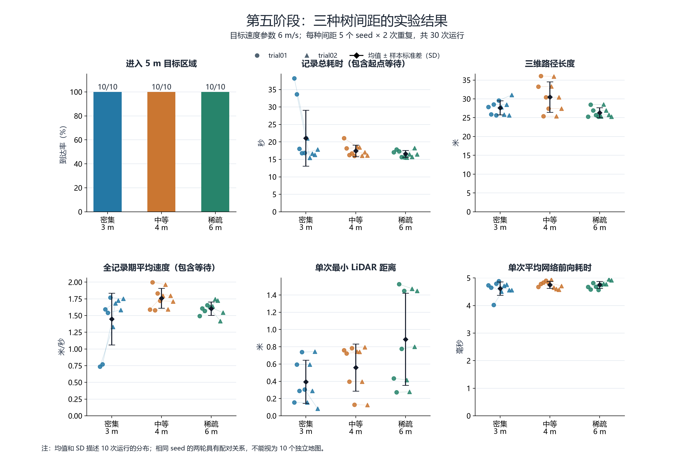
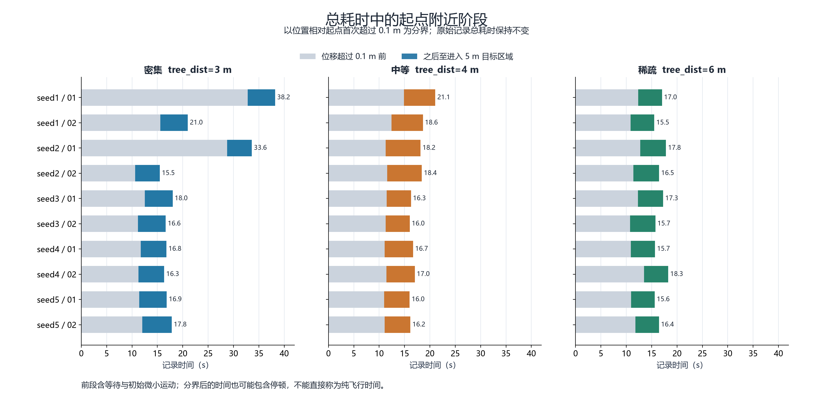
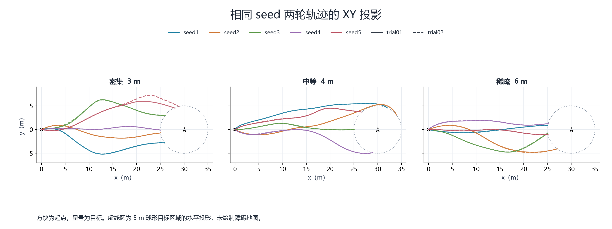

# 第五阶段实验报告：随机森林树间距对 YOPO 导航表现的影响

更新日期：2026-10-11。数据范围：trial01 与 trial02，共 30 次运行。每种树间距为 5 个 seed、每个 seed 重复 2 次。

## 2. 实验开始前填写

**研究问题：** 在模型、目标速度和起终点设置相同的条件下，改变随机森林树间距，会如何影响 YOPO 的目标区域到达情况、路径、耗时、障碍距离和网络推理耗时？同一 seed 重复运行是否得到接近的结果？

**选择该问题的原因：** 树间距改变了森林的疏密程度，适合用于比较不同障碍环境下的导航表现。重复相同 seed 有助于区分场景之间的差异与重复运行产生的差异。

**准备修改的参数：** 仿真地图配置中的 tree_dist；seed 作为不同随机场景的编号。trial01、trial02 仅区分同一条件的重复记录，不能改变模型权重的 --trial 参数。

**参数设置：**

| 项目 | 设置 |
|---|---|
| 场景 | 随机森林，random_map=true，maze_type=5 |
| 自变量 | tree_dist=3、4、6 m，分别标记为 dense、medium、sparse |
| seed 与重复 | 每种间距采用 seed=1–5，每个 seed 运行 trial01、trial02 各一次 |
| 实验总数 | 3 种间距 × 5 个 seed × 2 次重复 = 30 次 |
| 目标速度参数 | velocity=6.0 m/s；并不表示全程实际速度恒为 6 m/s |
| 起点、目标 | 起点约 (0,0,2.008) m，目标 (30,0,2) m |
| 到达判据 | 记录器三维目标距离 ≤5 m；规划器内部到达判断为 <5 m |
| 模型 | 沿用 YOPO_1/epoch50.pth；启动参数 --trial=1 --epoch=50 |
| 统计范围 | 两轮有效记录全部保留；不纳入 excluded_records 历史排除记录 |
| 分析指标 | 到达率、记录总耗时、路径长度、平均速度、最小 LiDAR 距离、平均网络前向耗时 |

**保持不变的参数：** 模型与权重、目标速度参数 6 m/s、随机森林场景类型、目标坐标和 5 m 到达阈值。两轮沿用原有规划器及记录器。随包附上的代码与 YAML 为 2026-10-05 提供的快照；本次数据压缩包未包含新代码，不能单凭这些旧快照独立证明每次运行使用的程序或地图完全相同。

**评价指标：** 采用上表指标，不进行碰撞次数分析。最小 LiDAR 距离仅作为传感器测距参考，不等于机体与障碍物的几何净空，也不能替代碰撞判定。

**每组重复次数：** 每种树间距 5 个 seed，每个 seed 2 次，共 10 次运行。相同 seed 的两次记录是重复测量，不能视为 10 个独立地图样本。

**预期实验结果：** 预计树间距减小时导航难度可能增加，运行时间或路径可能增大，障碍测距可能减小；预计平均网络前向耗时相对稳定。这些是实验假设，实际结论以数据为准。

## 3. 实验完成后回答

**实验结果是什么：** 30 次记录均从约 (0,0,2.008) m 开始，并进入目标点周围 5 m 判定区域；最终误差为 4.954–4.998 m。各组到达率均为 10/10，不能表述为精确到达 (30,0,2)。

下表为单次运行指标的等权均值 ± 样本标准差（分母 n−1）；每组 n=10 次运行，来自 5 个 seed 的两轮重复。标准差用于描述这些运行的离散程度，不是标准误或置信区间。

| 指标 | 密集 td=3 | 中等 td=4 | 稀疏 td=6 |
|---|---:|---:|---:|
| 进入 5 m 目标区域 | 10/10 | 10/10 | 10/10 |
| 记录总耗时（s，含起点等待） | 21.08 ± 8.03 | 17.44 ± 1.63 | 16.59 ± 0.98 |
| 路径长度（m） | 27.63 ± 1.86 | 30.50 ± 4.04 | 26.35 ± 1.30 |
| 全记录期平均速度（m/s） | 1.45 ± 0.39 | 1.76 ± 0.15 | 1.60 ± 0.10 |
| 每次最小 LiDAR 距离的组均值（m） | 0.39 ± 0.25 | 0.56 ± 0.27 | 0.89 ± 0.54 |
| 每次平均网络前向耗时的组均值（ms） | 4.62 ± 0.24 | 4.75 ± 0.13 | 4.75 ± 0.13 |
| 最终目标误差（m） | 4.975 ± 0.013 | 4.987 ± 0.015 | 4.986 ± 0.013 |

**结果是否符合预期：** 部分符合。最小 LiDAR 距离的组均值随间距由 3 m 增至 6 m 而增大。路径长度没有随间距单调变化，中等间距的平均路径最长。各组均达到 5 m 区域，当前样本无法区分到达率。记录总耗时和全记录期平均速度受到起点等待影响，不能直接据此断言密集环境导致飞行更慢。网络前向耗时均值约为 4.62–4.75 ms，未表现出明显的单调变化。

**可能原因是什么：** 路径受到具体地图布局与局部规划选择影响，不只取决于树间距。记录器在收到目标消息时开始计时，而规划器可能尚未开始驱动无人机移动，导致总耗时中存在较长的起点附近阶段。原始轨迹能够确认这种时间结构，但无法单独判定其中有多少来自手动启动、模型加载、消息时序或其他等待。

两轮比较如下；最后一列是事后统一增加的诊断指标，不替换原有 flight_time_s：

| tree_dist | trial01 总耗时（s） | trial02 总耗时（s） | 位移超过 0.1 m 后至达标（两轮，s） |
|---|---:|---:|---:|
| 3 m | 24.70 ± 10.38 | 17.46 ± 2.15 | 5.29 ± 0.30 |
| 4 m | 17.64 ± 2.08 | 17.25 ± 1.23 | 5.70 ± 0.81 |
| 6 m | 16.69 ± 1.00 | 16.49 ± 1.08 | 4.82 ± 0.18 |

**是否出现异常实验：** 本次核对未发现重复 run_id、缺失轨迹、名称与 seed/tree_dist 不一致，或轨迹终点与汇总不一致。30 条 other_anomalies 均为空；逐样本时间戳递增，最大间隔约 0.017 s。日志未标记异常不等于已经证明不存在任何异常。密集组 seed1、seed2 第一轮总耗时偏长，主要差异集中在开始明显移动之前，因此保留记录并解释，不因耗时较大而删除。

| 条件 | 轮次 | 记录总耗时（s） | 位移超过 0.1 m 前（s） | 之后至达标（s） |
|---|---|---:|---:|---:|
| td3 / seed1 | trial01 | 38.21 | 32.81 | 5.40 |
| td3 / seed1 | trial02 | 21.00 | 15.60 | 5.40 |
| td3 / seed2 | trial01 | 33.63 | 28.76 | 4.87 |
| td3 / seed2 | trial02 | 15.49 | 10.62 | 4.87 |

时间拆分方法：起始时刻由“最后一条里程计时间戳 − 汇总记录总耗时”还原；以三维位置相对起点首次超过 0.1 m 为分界。前段包含等待与初始微小运动，后段包含之后的所有运动或停顿。0.1 m 是本次分析选定的诊断阈值，不是原记录器新增的启动判据；结果不是严格定义的纯飞行时间。它表明 dense/seed1 两轮的后段均约 5.40 s，不能把 38.21 s 与 21.00 s 的差异归结为飞行速度变化。

**实验次数是否足够：** 30 次运行足以形成当前 3 种间距、每种 5 个 seed 的初步描述与重复性检查。每个 seed 只有 2 次重复，独立场景数量有限，尚不足以稳定估计低概率失败率或给出普遍性能结论。这里未实施显著性检验，不能将组均值差异称为统计显著。

**当前能够得到什么结论：** 在已记录条件与 5 m 阈值下，30 次运行全部达标；稀疏组路径均值最短，中等组最长；最小 LiDAR 距离的组均值随间距增加而增大。两轮相同条件的路径多数接近，但密集组 seed5 也存在路径变化。总耗时受起点附近阶段影响较大，后续应统一启动和计时口径。

**当前还不能得到什么结论：** 不能证明零碰撞、精确到达目标、真实无人机上的同等效果，或对所有森林场景均有效；不能将原始总耗时差异直接解释为导航效率差异。summary 中 seed 与文件名一致只证明记录元数据一致，不独立证明每次地图确实按对应 seed 重建。本包没有逐次地图快照、配置哈希、实际 GPU 使用日志及推理事件序列。

**下一步还可以研究什么：** 在统一自动启动流程下增加 seed 数量和重复次数；提前定义移动开始时刻，并分别记录等待时间与运动阶段时间；每次运行自动保存地图配置与代码版本。完成这一改进后，再研究更高密度或不同速度设置，并保持到达阈值一致。

## 4. 本阶段提交材料

| 材料 | 本包对应内容 |
|---|---|
| 实验设计表 | 本报告第 2 节及 experiment_design.md |
| 参数配置文件 | current_config_snapshot/config.yaml、traj_opt.yaml；逐次记录参数见 summary.csv |
| 代码修改记录 | code_change_record.md；现有运行脚本快照；analysis/analyze_stage5.py |
| 原始实验数据 | summary.csv 与 raw/ 下 30 份轨迹；保持原始内容 |
| 实验结果图表 | 本报告统计表、三张 PNG；group_statistics.csv 与 run_metrics.csv |
| 结果分析报告 | 本报告第 3 节及时间拆分分析 |
| 个人总结 | 本报告下节，可直接复制 |
| GitHub 仓库更新记录 | github_update_record.md；仓库 dev 分支提交历史 |

## 5. 个人总结

本阶段围绕随机森林树间距开展了 30 次仿真实验，完成了三种间距、五个 seed 和两轮重复的数据记录与整理。实验中，我认识到实验名称、记录器参数和实际地图配置必须保持一致，原始数据应当保留，错误记录应单独归档。同一条件重复运行也帮助我发现，总耗时较长并不一定意味着飞行过程更慢，记录开始到实际移动之间的等待会影响统计结果。通过核对轨迹与汇总数据，我进一步明确了 5 m 到达阈值、平均速度和推理耗时的含义。后续将优先统一实验启动及计时方式，自动保存每次运行配置，并扩大场景数量，使实验结果更容易复现和比较。

## 附录：指标口径与可复现性

- 数据来源为 2026-10-11 提供的 stage5_experiment.zip。summary.csv 包含两轮全部 30 条有效记录，raw/ 为 30 份原始里程计 CSV。既有 trial01 数据未被新轮次覆盖。
- flight_time_s 为记录器从接收目标时所持有的最新里程计时刻至达标时刻的差；包含等待。avg_speed_mps 为记录期速度模长按相邻时间差加权的平均值，并非设定速度。
- path_length_m 为相邻三维位置间距离累计值。报告对每个采样点重算了速度模长、累计路径和目标距离，并重算了全记录期平均速度。
- min_lidar_range_m 为活动记录期间点云点到传感器原点距离的最小值，本次也与轨迹中缓存的测距最小值一致。未获得机体表面净空或真实接触标签。
- avg_inference_ms 取自 summary。代码快照在 self.policy 前向计算两侧计时，CUDA 路径含同步，排除前面的深度预处理与后面的输出转 CPU/后处理；本包没有逐次推理事件流，不能从里程计重算该均值。
- 每组平均推理耗时是各次运行均值的等权平均，不是全部推理事件按事件数加权的平均。组内标准差均按单次运行指标计算。
- current_config_snapshot 为之前提交的四份文件原样保留，config.yaml 显示 td6/seed5 的最终设置。不可把单份最终配置当作 30 次配置快照；模型权重本体也未包含在本次数据包中。
- 离线核对不修改或重新运行 ROS 规划器。复现本报告可在安装 numpy、matplotlib 后，从 stage5_experiment 目录执行 python analysis/analyze_stage5.py。脚本读取 summary.csv 与 raw/，仅更新分析产物及文档。

轨迹图为 XY 投影，各色表示 seed，线型表示重复轮次。目标区域圆为半径 5 m 球形到达区域的水平投影，实际判据使用三维距离。未提供地图点云，因此图中不绘制障碍物。
